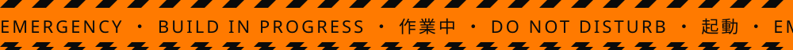

  

  <b>Full-stack developer. Co-founder of <a href="https://saturdaycompany.it">Saturday Company</a>.</b> 
  I build AI-powered web and mobile products, and the agents that build them with me.

  

## Current operations

  

| | | |
|---|---|---|
| **[Monsters](https://github.com/Saturday-Company/monsters)** | A local, provider-agnostic agentic hub: an orchestrator and a squad of little monsters on your machine. | [getmonsters.dev](https://getmonsters.dev) |
| **[SuspiciousDog](https://github.com/Saturday-Company/SuspiciousDog)** | Sniffs your AI agent transcripts for what actually works. He doesn't trust your plugins. | `sdog sniff` |
| **[Saturday Company](https://saturdaycompany.it)** | AI consulting and products for companies and public bodies: WitDesk, Anteiku, custom tools. | [saturdaycompany.it](https://saturdaycompany.it) |

## Arsenal

  
  
  
  
  
  
  
  
  
  

## Off duty

Evangelion, more than is healthy. Anime and manga. Competitive Beyblade X, and the club that comes with it.
Trading card games, video games, worldbuilding, local LLMs.

  

Animated SVGs drawn in code (`scripts/build.py`), type set in Noto Serif CJK and Noto Sans CJK (SIL OFL), embedded.
